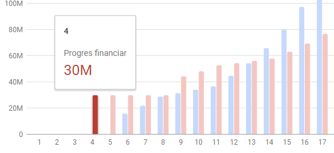

# Scalable Vector Graphics - SVG
<!-- vscode-markdown-toc -->
* 1. [Objectives](#Objectives)
* 2. [What is it?](#Whatisit)
* 3. [Documentation](#Documentation)
* 4. [Assignment (solved)](#Assignmentsolved)
* 5. [Assignment (for you to try)](#Assignmentforyoutotry)
* 6. [Bibliography](#Bibliography)

<!-- vscode-markdown-toc-config
	numbering=true
	autoSave=true
	/vscode-markdown-toc-config -->
<!-- /vscode-markdown-toc -->

##  1. <a name='Objectives'></a>Objectives
- creating an SVG element using JavaScript;
- adding various elements in the SVG and setting their attributes (coordinates, width, height, etc.);
- applying CSS styles to SVG Elements;
- subscribing to the events triggered on the SVG elements.

##  2. <a name='Whatisit'></a>What is it?
**Scalable Vector Graphics (SVG)** is an
[XML](https://developer.mozilla.org/en-US/docs/XML)-based markup language for
describing two-dimensional [vector
graphics](https://en.wikipedia.org/wiki/Vector_graphics). SVG is essentially to
graphics what [HTML](https://developer.mozilla.org/en-US/docs/Web/HTML) is to
text. SVG is similar to Adobe's proprietary Flash technology, but it is a
text-based open Web standard instead of a closed binary format. It is explicitly
designed to work with other web standards such as
[CSS](https://developer.mozilla.org/en-US/docs/CSS),
[DOM](https://developer.mozilla.org/en-US/docs/DOM), and
[SMIL](https://developer.mozilla.org/en-US/docs/Web/SVG/SVG_animation_with_SMIL).

##  3. <a name='Documentation'></a>Documentation

-   SVG: <https://developer.mozilla.org/en/docs/Web/SVG>

##  4. <a name='Assignmentsolved'></a>Assignment (solved)

Let's imagine that we are asked to implement a simple JavaScript **bar chart** library, having the following requirements:
 - anyone should be able to use our library by referencing a **single** `*.js` file;
 - the library should **not** have any dependencies on other libraries (such as: jQuery, D3.js, etc.);
 - the library should provide sensible default colors and strokes without requiring CSS from the page;
 - the consuming page should be able to customize the chart (ex: change the bars' color on hover using CSS).

>Try the complete `svg-bar-chart` sample by clicking [here](https://ase-multimedia.azurewebsites.net/svg-bar-chart/).


As an example, you can find below the code required for displaying a **bar chart** using the [Google Charts](https://developers.google.com/chart/interactive/docs/gallery/barchart) library:

**HTML**
```HTML
  <script src="https://www.gstatic.com/charts/loader.js"></script>

  <div id="chart_div"></div>
```
**JavaScript**
```JavaScript
google.charts.load('current', {packages: ['corechart', 'bar']});
google.charts.setOnLoadCallback(drawBasic);

/**
 * Draws the chart after the Google Charts packages have loaded.
 * @returns {void}
 */
function drawBasic() {
    const data = google.visualization.arrayToDataTable([
        ['City', '2010 Population',],
        ['New York City', 8175000],
        ['Los Angeles', 3792000],
        ]);

    const options = {
        title: 'Population of Largest U.S. Cities',
        hAxis: {
            title: 'Total Population',
            minValue: 0
        },
        vAxis: {
            title: 'City'
        }
    };

    const chart = new google.visualization.BarChart(document.getElementById('chart_div'));
    chart.draw(data, options);
}
```

The local sample is in [`code-examples/svg-bar-chart`](code-examples/svg-bar-chart/). To build it yourself, create a folder called `svg-bar-chart` and follow the steps below. The Google Charts loader above is only used for the comparison example; our library has no external dependencies.

1. Add an `HTML` file called `index.html` and add the code included below.

    ```HTML
    <!DOCTYPE HTML>
    <html lang="en">

    <head>
        <title>SVG Bar Chart</title>
        <meta charset="utf-8">
        <meta name="viewport" content="width=device-width, initial-scale=1">
    </head>

    <body>
        <div id="barChart" style="width: 600px; height:400px;"></div>
    </body>

    </html>
    ```

2. Add this module script after the chart container, just before `</body>`. The `import` makes the exported `BarChart` class available in this script. Module scripts run after the HTML has been parsed, so the container exists when the constructor runs.

    ```HTML
    <script type="module">
        import { BarChart } from './svg-bar-chart-library.js';

        const data = [
            ['Label 1', 1],
            ['Label 2', 2],
            ['Label 3', 3],
        ];

        const barChart = new BarChart(document.getElementById("barChart"));
        barChart.draw(data);
    </script>
    ```
3. Add a `JavaScript` file called `svg-bar-chart-library.js` next to `index.html`. Declare the exported `BarChart` class and add a constructor that creates the SVG and appends it to the container. Complete steps 4–7 before running the page: the class needs its drawing methods and the private `#createSVG()` method defined below.
    
    ```JavaScript
    export class BarChart{
        #svgns = "http://www.w3.org/2000/svg";
        /** @type {SVGSVGElement} */
        #svg;

        /**
         * Creates a chart in the supplied container.
         * @param {HTMLElement} domElement The HTML container that will hold the chart.
         */
        constructor(domElement) {
            this.#createSVG();
            domElement.appendChild(this.#svg);
        }
    }
    ```
4. Add the `draw()` method inside the class. It clears the previous drawing so that later calls replace the bars instead of accumulating them. Keep the SVG itself attached to the container.

    ```JavaScript
    /**
     * Displays the supplied labels and values.
     * @param {Array<[string, number]> | null} [data] An empty array, null, or an omitted value clears the chart.
     * @returns {void}
     */
    draw(data){
        this.#svg.replaceChildren();
    }
    ```
5. Add the private `#createSVG()` method inside the class. The constructor calls it once. The SVG fills the container, whose dimensions were set in step 1.

    ```JavaScript
    /**
     * Creates the SVG drawing surface.
     * @returns {void}
     */
    #createSVG(){
        this.#svg = document.createElementNS(this.#svgns, "svg");
             
        this.#svg.style.borderColor = 'black';
        this.#svg.style.borderWidth = '1px';
        this.#svg.style.borderStyle = 'solid';
        //or
        //this.#svg.setAttribute('style', 'border: 1px solid black'); 
        
        this.#svg.setAttribute('width', '100%'); //note: this.#svg.width is readonly
        this.#svg.setAttribute('height', '100%');
    }
    ```
6. Set the background color by adding this line to `#createSVG()`, after the border styles. This matches the local sample, and the background remains when `draw()` clears the SVG's children.

    ```JavaScript
    this.#svg.style.backgroundColor = 'WhiteSmoke';
    ```

    For a classroom comparison, the background can instead be an SVG rectangle. To try this alternative, omit the background-color line, add the method below inside the class, and call `this.#drawBackground()` immediately after `this.#svg.replaceChildren()` in `draw()`. Repeat that call in the replacement `draw()` method in step 7 so the background is recreated before the bars on every redraw.

    ```JavaScript
    /**
     * Draws an optional background rectangle behind the bars.
     * @returns {void}
     */
    #drawBackground(){
        const rect = document.createElementNS(this.#svgns, 'rect');
        rect.setAttribute('x', 0);
        rect.setAttribute('y', 0);
        rect.setAttribute('height', this.#svg.clientHeight);
        rect.setAttribute('width', this.#svg.clientWidth);
  
        rect.style.fill = 'WhiteSmoke';
        //or: use a presentation attribute, which CSS rules can override
        //rect.setAttribute("fill", 'WhiteSmoke');
    
        this.#svg.appendChild(rect);
    }
    ```
7. Replace the `draw()` method from step 4 with the following version to draw the bars. The SVG is already attached to the page, so its rendered width and height are available. Here, `barWidth` is the width of a category's slot; each rectangle occupies the middle half of that slot.

    Passing `[]`, `undefined`, or `null` clears the bars and labels. Calling `draw()` without an argument does the same. The check `data == null` covers both `null` and `undefined`. For nonempty data, this example assumes `[label, value]` pairs with finite, nonnegative values. When every value is zero, the scale factor is zero so each label is drawn with a zero-height bar. It uses a fixed-size container. A complete library would validate input and update its geometry when the container is resized.

    ```JavaScript
    /**
     * Displays the supplied labels and values.
     * @param {Array<[string, number]> | null} [data] An empty array, null, or an omitted value clears the chart.
     * @returns {void}
     */
    draw(data){
        // Clear the chart
        this.#svg.replaceChildren();

        if (data == null || data.length === 0) {
            return;
        }

        // Add the bars
        const barWidth = this.#svg.clientWidth / data.length;

        const maxValue = Math.max(...data.map(([, value]) => value));
        const f = maxValue === 0 ? 0 : this.#svg.clientHeight / maxValue;

        for(let i=0; i<data.length; i++){

            const label = data[i][0];
            const value = data[i][1];

            const barHeight = value * f * 0.9;
            const barY = this.#svg.clientHeight - barHeight;
            const barX = i * barWidth;

            const bar = document.createElementNS(this.#svgns, 'rect');
            bar.classList.add('bar');
            //or
            //bar.setAttribute('class', 'bar');
            bar.setAttribute('x', barX + barWidth / 4);
            bar.setAttribute('y', barY);
            bar.setAttribute('height', barHeight);
            bar.setAttribute('width', barWidth / 2);

            // Presentation attributes provide defaults that page CSS can override.
            bar.setAttribute('fill', '#db4437');
            bar.setAttribute('stroke-width', '2');
            bar.setAttribute('stroke', 'black');
            this.#svg.appendChild(bar);
        }
    }
    ```

8. Demonstrate optional page-level customization by adding the following CSS inside a `<style>` element in the `<head>` of `index.html`. The library already supplies the default fill and stroke through SVG presentation attributes, so it works without page CSS. The `.bar:hover` rule overrides the default fill while a bar is hovered. An inline assignment such as `bar.style.fill = '#db4437'` would override the normal hover rule, which is why the library uses presentation attributes instead. Hover behavior belongs to this example page, not to the library.

    ```CSS
    .bar:hover {
        fill: yellow;
    }
    ```

9. Inside the `draw()` loop, add the following code immediately after `this.#svg.appendChild(bar)` to display each label. The `x` coordinate is the center of the category's slot, and `text-anchor="middle"` centers the text on that coordinate.

    ```JavaScript
    const text = document.createElementNS(this.#svgns, 'text');
    text.textContent = label;
    text.setAttribute('x', barX + barWidth / 2);
    text.setAttribute('y', this.#svg.clientHeight - 5);
    text.setAttribute('text-anchor', 'middle');
    this.#svg.appendChild(text);
    ```

>**Remarks:** To reuse the library, provide a container with explicit dimensions, import `BarChart` from `svg-bar-chart-library.js` in a module script, instantiate the class with the container, and call `draw()` with an array of `[label, value]` pairs that meets the assumptions in step 7. Page CSS is optional and can customize the library's default appearance through the `.bar` class.

##  5. <a name='Assignmentforyoutotry'></a>Assignment (for you to try)
The Google Charts library supports many more features than our library, as you can see in the screenshot bellow. 



1. Display the value corresponding to a bar when clicking on it.
Hint: Attach a handler to the `click` event of the bars. 
2. Comment the CSS code used for changing the color of the bars (".bar:hover"). Implement the same functionality using JavaScript.
Hint: You need to handle the mouse events.
3. Display the horizontal and vertical axes (as shown above).
4. Display tooltips when the user hovers over the bars in you chart (as shown above).
Hint: Check the type of element that is used in the Google Charts library
5. (optional) Check the [D3.js](https://d3js.org/) library. Reimplement the example above using this library.

##  6. <a name='Bibliography'></a>Bibliography
-   SVG: <https://developer.mozilla.org/en/docs/Web/SVG>
